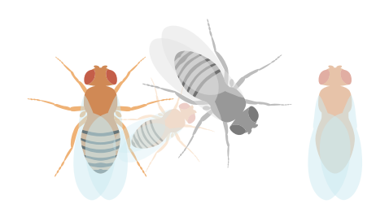
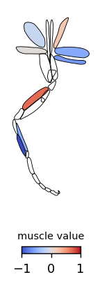
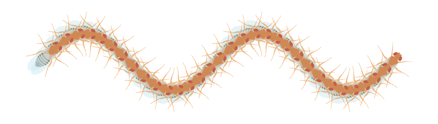

# flyplotlib

[](https://badge.fury.io/py/flyplotlib)
[](https://github.com/tkclam/flyplotlib/blob/main/LICENSE)

**flyplotlib** adds vector graphics of fruit flies (*Drosophila melanogaster*) and
their leg muscles to [matplotlib](https://matplotlib.org/) plots. Use it to
illustrate trajectories, orientations, schematics, and to color leg muscles by
per-muscle values (e.g. activity or connectivity).

<p align="center">
  
  
</p>

## Installation

```sh
pip install flyplotlib
```

or with [uv](https://docs.astral.sh/uv/):

```sh
uv add flyplotlib
```

Requires Python ≥ 3.10. The runtime dependencies are `matplotlib`, `numpy`,
`shapely` and `svg2mpl`.

## Usage

### Add flies to a plot

```python
import matplotlib.pyplot as plt
from flyplotlib import add_fly

fig, ax = plt.subplots()
add_fly(xy=(0, 0), ax=ax)
add_fly(xy=(2, -0.5), rotation=30, length=2, alpha=0.3, ax=ax)
add_fly(xy=(3.5, 0), rotation=-45, grayscale=True, ax=ax)
add_fly(xy=(6.5, 0), alpha=0.5, exclude=["leg", "stripe", "haltere"], ax=ax)
ax.set_aspect(1)
```

`add_fly` accepts a position (`xy`), `rotation` in degrees, a `length`, and any
matplotlib patch keyword (e.g. `alpha`, `edgecolor`). Parts can be hidden with
`exclude` (regular expressions matched against SVG path IDs).

Flies are aligned by their body, so they line up nicely along a trajectory:

```python
import numpy as np

fig, ax = plt.subplots(figsize=(7, 2))
for x in np.arange(4 * np.pi, 0, -np.pi / 8):
    add_fly(xy=(x, np.sin(x)), rotation=np.rad2deg(np.arctan(np.cos(x))), length=1.2, ax=ax)
ax.set_aspect(1)
```

<p align="center"></p>

### Color leg muscles by value

`mushow` ("muscle imshow") colors each leg muscle by a scalar value and returns a
`ScalarMappable` you can pass to `colorbar`:

```python
import matplotlib.pyplot as plt
from flyplotlib import mushow, Segment

values = {
    Segment.TIBIA_EXTENSOR: 0.707,
    Segment.TARSUS_LEVATOR: -1.0,
    # names are parsed leniently, so this also works:
    "Sternal adductor MN": -0.638,
}

fig, ax = plt.subplots(figsize=(2.5, 4))
paths, mappable = mushow(values, cmap="coolwarm", vmin=-1, vmax=1)
ax.set_aspect("equal")
ax.axis("off")
fig.colorbar(mappable, ax=ax, shrink=0.35, orientation="horizontal")
```

Muscles without a value (or with `nan`) are left uncolored. Muscle names are
resolved by `Segment.from_str`, which tolerates different separators,
abbreviations and word order (`"Tibia extensor MN"`, `"tibia_extensor"` and
`"ti-extensor"` all map to `Segment.TIBIA_EXTENSOR`).

### Style individual muscles

For full control, use `add_muscles`, which returns a dict of patches keyed by
SVG ID, or accepts `per_path_kwargs` to style muscles by `Segment`:

```python
from flyplotlib import add_muscles, Segment

patches = add_muscles(
    per_path_kwargs={"facecolor": {Segment.TIBIA_EXTENSOR: "#f9dd16"}},
)
patches["Ti-flexor"].set_edgecolor("k")
```

### Custom SVGs

`add_paths` draws any SVG file (its `<path>` elements), so you can use your own
artwork with the same placement/rotation/scaling API:

```python
from flyplotlib import add_paths

add_paths("my_drawing.svg", xy=(1, 2), rotation=45, width=3)
```

### Add a posed NeuroMechFly

`add_neuromechfly` draws a fly cartoon in an arbitrary posture, built from the
[NeuroMechFly v2](https://github.com/NeLy-EPFL/flygym) biomechanical model. Given
joint angles and a view, it runs forward kinematics on the model's body segments,
projects them orthographically, and fills the silhouette of each segment's
projected mesh (z-ordered by depth):

```python
import matplotlib.pyplot as plt
from flyplotlib import add_neuromechfly

fig, ax = plt.subplots()
add_neuromechfly(view="right", ax=ax)          # neutral standing pose
ax.set_aspect("equal")
ax.autoscale()
```

`joint_angles` is a mapping of DOF name (`"{parent}-{child}-{axis}"`, e.g.
`"c_thorax-lf_coxa-pitch"`) to angle in degrees (pass `degrees=False` for radians,
to feed flygym simulation output directly). Unspecified DOFs fall back to the
neutral standing pose, so any subset can be set:

```python
add_neuromechfly(
    joint_angles={
        "c_thorax-lf_coxa-pitch": 60,
        "lf_coxa-lf_trochanterfemur-pitch": -60,
        "lf_trochanterfemur-lf_tibia-pitch": 40,
    },
    view="right",
)
```

`view` is one of `"left"`, `"right"`, `"front"` or `"back"`; placement
follows the same `xy`/`rotation`/`length`/`origin` API as `add_fly`. Segments are
drawn with black outlines by default (pass `edgecolor="none"` to disable) and
lightly smoothed to remove the mesh's triangle "staircase" (tune or disable via
`smoothing`). Segments can be hidden with `exclude` (regular expressions on segment
names, e.g. `"wing"` or `"r._"` for the right legs) and recolored with `colors` (a
`{pattern: color}` mapping); colors otherwise come from the model itself.
`neutral_pose()` and `neuromechfly_segments()` list the available DOF and segment
names.

The body meshes and model metadata are bundled with the package, so this needs no
`flygym`/`mujoco`. The silhouette of a given pose/view is cached, so laying out
many flies (e.g. varying only `xy`/`rotation`/`length`) is cheap.

## Performance

Parsing an SVG and computing its exact (Bézier) bounding box is expensive, so
both are cached per file. Repeated `add_fly`/`add_muscles` calls — common when
laying out many flies — reuse the cached geometry and run roughly **25× faster**
than re-parsing each time (~0.5 ms vs ~13 ms per call on the bundled fly).

## Development

This project uses [uv](https://docs.astral.sh/uv/):

```sh
git clone https://github.com/tkclam/flyplotlib
cd flyplotlib
uv sync --extra examples   # create the environment
uv run pytest              # run the test suite
uv run ruff check          # lint
uv run ruff format         # format
```

Runnable examples live in [`examples/`](examples/).

## Citing

The fly leg muscle anatomy and motor neuron naming follow Lesser et al. (2024),
*Connectomic reconstruction of a female Drosophila ventral nerve cord*, Nature.
https://doi.org/10.1038/s41586-024-07389-x

`add_neuromechfly` uses meshes and rigging from the
[flygym](https://github.com/NeLy-EPFL/flygym) project (Apache-2.0; see
`src/flyplotlib/data/neuromechfly/NOTICE`), the NeuroMechFly v2 model of
Wang-Chen et al. (2024), *NeuroMechFly v2, simulating embodied sensorimotor
control in adult Drosophila*, Nature Methods.
https://doi.org/10.1038/s41592-024-02497-y

## License

[MIT](LICENSE)
